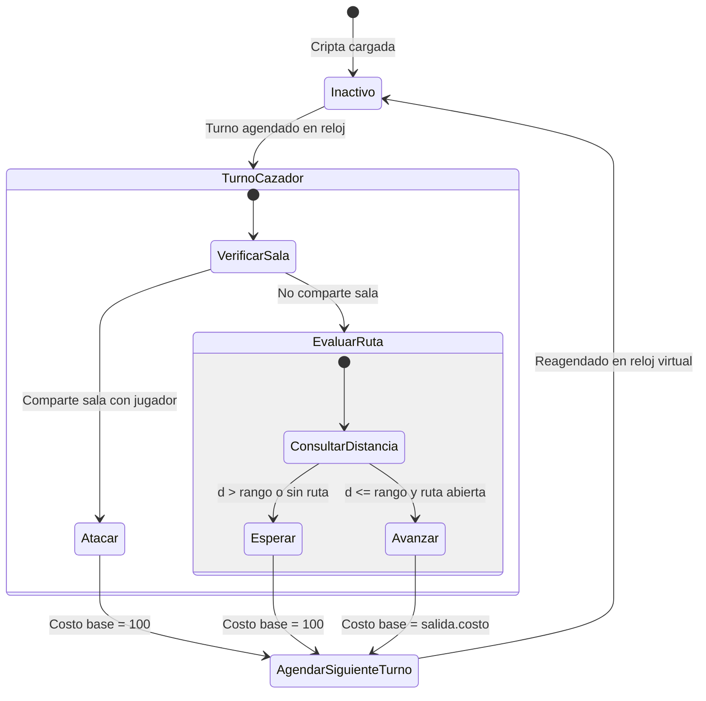

# Data Model: Terreno, cazador e invalidación de rutas

**Feature**: `001-terreno-cazador`  
**Date**: 2026-11-07  
**Constitution Authority**: `.specify/memory/constitution.md` (Version 1.0.0)

---

## 1. Entidades del Dominio

### 1.1 Salida (Modificada)
Representa la conexión bidireccional física entre dos salas adyacentes.

- **Campos**:
  - `sala_a`: Referencia a `Sala` en el primer extremo.
  - `sala_b`: Referencia a `Sala` en el segundo extremo.
  - `costo`: `int` $\ge 1$. Dificultad de tránsito del terreno. Por defecto 100 si se omite en el mapa. Es simétrico e idéntico para el cruce de $A \to B$ y de $B \to A$.
  - `estado`: `str` en `{"abierta", "cerrada"}`.
  - `llave`: `str | None`. Identificador de llave requerida si está cerrada.
  - `cierre_automatico`: `int | None`. Pulsos de reloj para autocierre tras abrirse.
  - `evento_cierre`: Referencia a `Evento | None` en la agenda.
- **Validaciones e Invariantes**:
  - `costo` es un entero estricto $\ge 1$.
  - Una salida es compartida por ambas salas: `sala_a.salidas[dir] is salida` y `sala_b.salidas[opuesta] is salida`.

### 1.2 Sala (Modificada)
Vértice del esqueleto de la cripta.

- **Campos**:
  - `id`: `int`. Identificador único entero provisto por la API/esqueleto.
  - `nombre`: `str`. Nombre descriptivo de la sala.
  - `indice`: `int`. Posición contigua $0 \le \text{indice} < N$ en el arreglo de salas del `Mapa`. Permite indexar arreglos de distancias en $O(1)$.
  - `salidas`: `list[Salida | None]` de longitud 4 (índices 0:N, 1:S, 2:E, 3:O).
  - `actores`: `list[Actor]`. Actores presentes en la sala.
  - `objetos`: `list[Objeto]`.
  - `trampas`: `list[Trampa]`.
  - `ultimo_instante_jugador`: `int | None`. Marca de rastro del jugador.
- **Validaciones e Invariantes**:
  - `id` es un entero no negativo. Los desempates entre salas comparan estrictamente `id_1 < id_2`.

### 1.3 Enemigo Cazador (Ampliación de Actor)
Enemigo con comportamiento persecutor guiado por costo mínimo.

- **Campos adicionales / específicos**:
  - `comportamiento`: `"cazador"`.
  - `rango`: `int` $\ge 0$. Distancia máxima acumulada de terreno que está dispuesto a recorrer para alcanzar al jugador.
  - `velocidad`: `int` $> 0$. Velocidad de movimiento y acción.
  - `evento_pendiente`: `Evento | None`. Próxima acción agendada en el reloj virtual.
- **Validaciones e Invariantes**:
  - Si comparte sala con el jugador al inicio de su turno, la acción mandatoria es atacar.
  - Si la distancia mínima calculada $d \le rango$, avanza un paso por la ruta óptima.
  - Si no hay ruta o $d > rango$, ejecuta una acción de espera con costo base 100.

### 1.4 CampoDistancias (Nueva Entidad de Caché Interna del Motor)
Estructura en memoria para la reutilización del cálculo compartido.

- **Campos**:
  - `id_sala_jugador`: `int`. Identificador de la sala del jugador desde la que se calculó el campo.
  - `rango_maximo`: `int`. Rango máximo de los cazadores activos considerado en la búsqueda.
  - `token_busqueda`: `int`. Contador de versión de búsqueda actual.
  - `distancias`: `list[int]`. Arreglo preasignado de longitud $N$ (indexado por `sala.indice`).
  - `marcas`: `list[int]`. Arreglo preasignado de longitud $N$ con el token de búsqueda.
  - `valido`: `bool`. Bandera de validez del campo compartido.
- **Invariantes**:
  - Es válido solo mientras el jugador no cambie de sala y ninguna puerta con al menos un extremo a distancia $\le rango\_maximo$ cambie de estado.

---

## 2. Transiciones de Estado y Ciclos de Vida



### 2.1 Reprogramación por Cambio de Velocidad
```mermaid
sequenceDiagram
    participant Motor as Motor/Agenda
    participant Actor as Actor (Jugador/Cazador)
    participant Efecto as Efecto de Velocidad
    
    Actor->>Motor: Inicia paso por salida costo C (v1) en t0
    Note over Motor: Programado t_fin = t0 + C*100//v1
    Efecto->>Actor: Cambia velocidad a v2 en t_cambio
    Efecto->>Motor: reprogramar_por_cambio_velocidad(evento, t_cambio, v1, v2)
    Note over Motor: restante = t_fin - t_cambio<br/>restante_nuevo = max(1, restante * v1 // v2)<br/>nuevo_evento = t_cambio + restante_nuevo
    Motor-->>Actor: Evento reagendado determinísticamente
```
