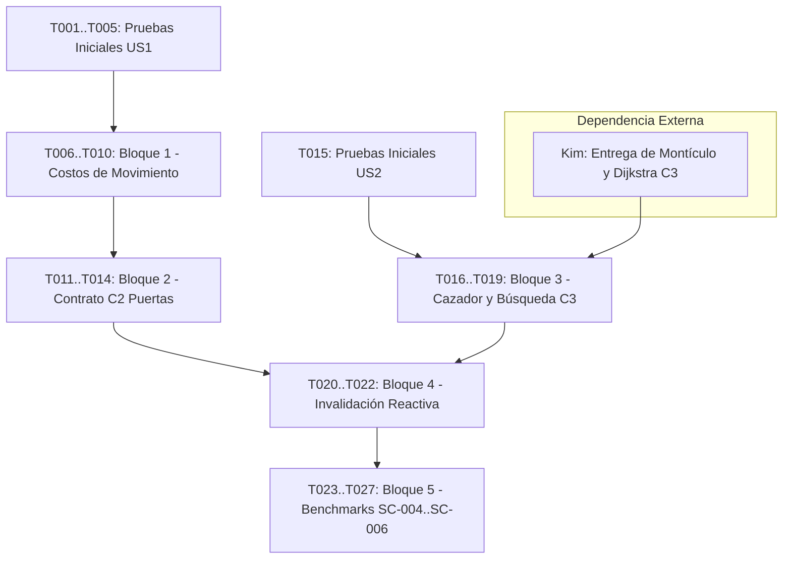

# Tasks: Terreno, cazador e invalidación de rutas

**Feature**: `001-terreno-cazador`  
**Spec**: [spec.md](spec.md) | **Plan**: [plan.md](plan.md)  
**Author**: Mariano (Motor del juego)

## Format: `[ID] [P?] [Story] Description (FR-xxx) -> Verificación`
- **[P]**: Tarea paralelizable (archivos distintos, sin dependencias mutuas directas).
- **[Story]**: Historia de usuario correspondiente (`[US1]`, `[US2]`, `[US3]`, `[BENCH]`).

---

## Phase 1: Pruebas de Aceptación Iniciales (Test-First)

**Propósito**: Escribir las pruebas automatizadas que definen el comportamiento esperado antes de tocar el código de producción.

- [ ] T001 [P] [US1] Crear archivo de pruebas `tests/test_terreno_cazador.py` e implementar pruebas de costo por defecto (100) y simetría de salida (FR-001). -> `python -m tests.test_terreno_cazador`
- [ ] T002 [P] [US1] Implementar pruebas en `tests/test_terreno_cazador.py` para la cota mínima de intervalo `max(1, costo*100//v)` con velocidad alta y costo 1 (FR-002). -> `python -m tests.test_terreno_cazador`
- [ ] T003 [P] [US1] Implementar prueba en `tests/test_terreno_cazador.py` para la reprogramación por cambio de velocidad en salida costosa ($t=0$, costo 300, $v=100 \to 50$ en $t=100$, nuevo $t=500$) (FR-002). -> `python -m tests.test_terreno_cazador`
- [ ] T004 [P] [US1] Implementar prueba en `tests/test_terreno_cazador.py` que compruebe que las acciones sin movimiento (atacar, esperar, usar, recoger, abrir) conservan sus costos base vigentes de P1 (FR-002). -> `python -m tests.test_terreno_cazador`
- [ ] T005 [P] [US1] Implementar prueba de compatibilidad de errantes y rastreadores con salidas de costos variables en `tests/test_terreno_cazador.py` (FR-002). -> `python -m tests.test_terreno_cazador`

---

## Phase 2: Infraestructura Fundacional y Bloque 1 (Costos de Movimiento)

**Propósito**: Modificar las entidades base del motor para soportar costos de terreno y conectar la agenda temporal. **(Autónomo: Mariano puede ejecutarlo de inmediato sin dependencias de otros integrantes)**.

- [ ] T006 [US1] Extender `Salida.__init__` y `Sala.conectar` en `modelo/juego/sala.py` para recibir y validar `costo: int = 100` ($\ge 1$), y agregar `Sala.indice` (FR-001). -> `python -m tests.test_terreno_cazador`
- [ ] T007 [US1] Modificar `modelo/juego/mapa.py` para leer `datos.get("costo", 100)`, asignar `sala.indice = p` y normalizar cadenas de comportamiento (FR-001). -> `python -m tests.test_motor_base`
- [ ] T008 [US1] Modificar `partida.mover` en `modelo/juego/partida.py` para pasar `salida.costo` en lugar de la constante `COSTO_MOVER` a `self._accion` (FR-002). -> `python -m tests.test_terreno_cazador`
- [ ] T009 [US1] Modificar `modelo/juego/comportamiento.py` para que `resolver_turno` retorne el costo de la acción ejecutada (`COSTO_ATACAR`, `COSTO_ESPERAR` o `salida.costo`) (FR-002). -> `python -m tests.test_terreno_cazador`
- [ ] T010 [US1] Actualizar `modelo/juego/motor_enemigos.py` para agendar el próximo turno del enemigo usando el costo retornado por `resolver_turno` (FR-002). -> `python -m tests.test_terreno_cazador`

**Checkpoint US1**: Todas las pruebas de `US1` (T001 a T005) deben pasar limpiamente. El costo variable de movimiento queda completamente operativo en el motor.

---

## Phase 3: Bloque 2 - Punto Central de Puertas y Contrato C2

**Propósito**: Unificar el control de estado de puertas y preparar el sistema de notificación para rutas, mapa conocido e historia. **(Autónomo: Mariano define el despachador y el manejo de retroceso)**.

- [ ] T011 [US3] Crear método `partida.cambiar_estado_puerta(salida, nuevo_estado)` en `modelo/juego/partida.py` que centraliza la mutación y emite avisos a observadores registrados (FR-008). -> `python -m tests.test_terreno_cazador`
- [ ] T012 [US3] Refactorizar `partida.abrir` en `modelo/juego/partida.py` y `efectos.programar_cierre` en `modelo/juego/efectos.py` para canalizar las mutaciones exclusivamente a través de `cambiar_estado_puerta` (FR-008). -> `python -m tests.test_partida`
- [ ] T013 [US3] Implementar en `partida.py` la gestión de retroceso: silenciar notificaciones individuales durante `registro.deshacer()` y emitir invalidación global de rutas al concluir el retroceso (FR-008). -> `python -m tests.test_terreno_cazador`
- [ ] T014 [US3] Agregar pruebas de aceptación de restauración de puertas tras uso de pergamino de retroceso en `tests/test_terreno_cazador.py` (FR-008). -> `python -m tests.test_terreno_cazador`

---

## Phase 4: Bloque 3 - Comportamiento del Cazador y Búsqueda (Contrato C3)

**Propósito**: Integrar la búsqueda de costo mínimo con montículo propio y desempate determinista por menor ID. *(Dependencia: Requiere la entrega de C3 de Kim para `monticulo_min.py`)*.

- [ ] T015 [P] [US2] Escribir pruebas de aceptación del cazador en `tests/test_terreno_cazador.py`: ataque al compartir sala, espera por falta de ruta, espera por $d > rango$, avance en límite exacto $d == rango$, preferencia de ruta más barata con más pasos y desempate por menor ID entero (FR-003, FR-004, FR-005, FR-006, FR-007). -> `python -m tests.test_terreno_cazador`
- [ ] T016 [US2] Integrar `monticulo_min.py` y función `dijkstra_acotado` provistos por Kim (Contrato C3) en `modelo/estructuras/` (FR-005). -> `python -m tests.test_terreno_cazador`
- [ ] T017 [US2] Implementar en `modelo/juego/cazador.py` el cálculo compartido desde la posición del jugador acotado a $R_{\max}$, con arreglos contiguos de tamaño $N$ indexados por `Sala.indice` y token de búsqueda $O(1)$ sin reinicialización (FR-005). -> `python -m tests.test_terreno_cazador`
- [ ] T018 [US2] Implementar en `modelo/juego/comportamiento.py` la función `_cazador(partida, enemigo)`: verificar sala compartida (atacar), consultar distancia mínima hacia el jugador, verificar $d \le rango$, desempatar por menor `id` de sala vecina abierta y avanzar agendando con `salida.costo` (FR-003, FR-004, FR-005, FR-006). -> `python -m tests.test_terreno_cazador`
- [ ] T019 [US2] Agregar prueba de aceptación de cazador operando con salas no descargadas y niebla de guerra activa del jugador, validando que no abre puertas cerradas (FR-007). -> `python -m tests.test_terreno_cazador`

**Checkpoint US2**: Pruebas de `US2` (T015 a T019) pasando. El cazador navega y ataca respetando el terreno y desempates.

---

## Phase 5: Bloque 4 - Invalidación Reactiva de Rutas

**Propósito**: Garantizar la equivalencia observable estricta con un cálculo desde cero ante eventos dinámicos.

- [ ] T020 [US3] Implementar en `modelo/juego/cazador.py` la lógica de invalidación reactiva: conservar distancias compartidas si el jugador no se movió y ninguna puerta con extremo a distancia $\le R_{\max}$ cambió de estado (FR-008). -> `python -m tests.test_terreno_cazador`
- [ ] T021 [US3] Conectar el despachador de puertas de `Partida` (Contrato C2) con la caché de rutas del cazador (FR-008). -> `python -m tests.test_terreno_cazador`
- [ ] T022 [US3] Agregar pruebas de aceptación en `tests/test_terreno_cazador.py` para:
  - Puerta de la ruta cerrada entre dos turnos del cazador (Apéndice B).
  - Apertura de puerta que desbloquea ruta previamente inaccesible dentro del rango.
  - Desplazamiento del jugador a una nueva sala entre turnos del cazador. -> `python -m tests.test_terreno_cazador`

**Checkpoint US3**: Todo el comportamiento observable coincide al 100% con un recálculo desde cero.

---

## Phase 6: Benchmarks y Rendimiento (SC-004, SC-005, SC-006, §5.6)

**Propósito**: Validar empíricamente los presupuestos y justificar las decisiones de diseño frente al profesor.

- [ ] T023 [BENCH] Crear `bench/bench_cazador.py` instrumentando la medición del tiempo de cada ciclo individual entre decisiones del jugador en cripta de referencia con decenas de cazadores, reportando `tiempo_maximo_ms` y conteo de ciclos que exceden los 20 ms (SC-004). -> `python main.py --bench cazador`
- [ ] T024 [BENCH] Implementar en `bench/bench_cazador.py` la comparación sistemática entre cálculo individual y compartido variando densidad (1, 10, 30 y 100 cazadores) y rangos (pequeño frente a grande) (SC-005). -> `python main.py --bench cazador`
- [ ] T025 [BENCH] Implementar en `bench/bench_cazador.py` la comparación entre reutilización con invalidación y recálculo continuo en escenarios con puertas estables e inestables, verificando equivalencia observable en cada paso (SC-006). -> `python main.py --bench cazador`
- [ ] T026 [BENCH] Repetir `bench/bench_motor.py` con cazadores activos y costos variables para contrastar el rendimiento de la agenda de eventos contra las mediciones de la primera parte (§5.6). -> `python -m bench.bench_motor`
- [ ] T027 [P] [BENCH] Registrar los resultados, gráficos o tablas comparativas y límites conocidos en el borrador de `DECISIONES.md` (§5.1 y §5.2).

---

## Dependencias y Orden de Ejecución

