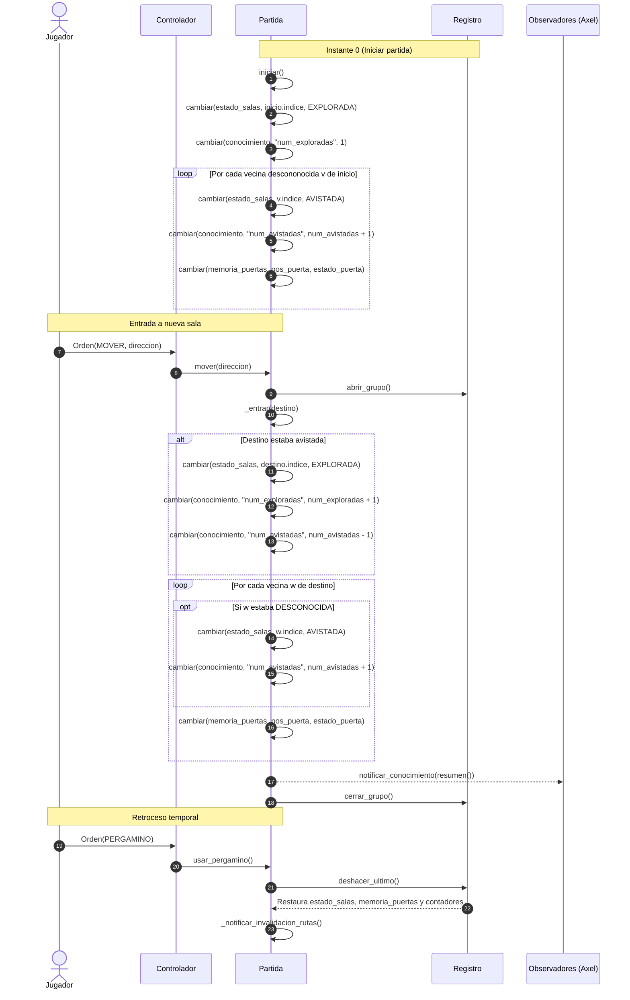

# Data Model: Niebla de guerra, mapa conocido y viaje automático "ir a"

**Feature**: `002-niebla-ir-a`  
**Date**: 2026-11-08  
**Constitution Authority**: `.specify/memory/constitution.md` (Version 1.0.0)

---

## 1. Entidades del Dominio

### Decisiones confirmadas para T003/T004

- Constructor: `ConocimientoMapa(n, salas_por_indice, mapa)`. Conserva ambas
  referencias, exige `salas_por_indice is mapa.salas` e índices contiguos.
- La construcción deja todas las salas y puertas desconocidas y los contadores
  en cero. FR-002 describe el inicio de Partida, no el constructor del contenedor.
- Consultas por Sala/índice y `resumen()` son O(1). `estado_por_id` delega en
  `mapa.sala`, cuya búsqueda binaria existente es O(log N).
- Observar una única puerta física permite recordar el mismo estado en sus dos
  posiciones. Esto no avista ni explora la sala del otro extremo, no descubre sus
  otras salidas y no autoriza revelar ID, nombre o contenido (FR-001..FR-005).
  La integración posterior en Partida escribirá ambas posiciones exclusivamente
  mediante `partida.cambiar`, si el jugador está en uno de los extremos (C2).
- `puerta_recordada_abierta(salida)` consulta solo la memoria de los dos extremos;
  devuelve False si falta algún recuerdo o discrepan. Nunca consulta el estado
  físico. El consumidor comprueba además que ambas salas estén exploradas (C3).
- El contenedor no realiza exploración, observación, conteo automático ni
  notificaciones. Partida mantendrá estados y contadores en el mismo grupo
  reversible. No se declara implementada la línea de tiempo de FR-013.
- Las pruebas unitarias están en `tests/test_conocimiento.py`; la aceptación de
  FR-002..FR-005 con Partida y vistas sigue pendiente en T004/T009..T014.

### 1.1 EstadoConocimiento (Constantes del dominio)
Representa el grado de percepción y certeza que el jugador tiene sobre una sala de la cripta.

- **Valores enteros**:
  - `ESTADO_DESCONOCIDA = 0`: La sala permanece en la niebla absoluta. No se muestra en el mapa, no se revelan conexiones y no se permite trazar rutas hacia ella.
  - `ESTADO_AVISTADA = 1`: La sala ha sido avistada desde una sala vecina explorada. El jugador sabe que existe una salida hacia un destino no identificado y conoce el costo de paso de la salida, pero desconoce el nombre, el identificador y el contenido interno.
  - `ESTADO_EXPLORADA = 2`: La sala ha sido visitada físicamente por el jugador o iluminada por el efecto de una antorcha encendida. El jugador conoce su nombre, identificador, todas sus salidas y costos, y recuerda el último estado de sus puertas.

- **Transiciones de Estado de Sala**:
  ```text
  [Desconocida (0)] --(Vecina de sala explorada)--------> [Avistada (1)]
  [Desconocida (0)] --(Entrada física / Antorcha)-------> [Explorada (2)]
  [Avistada (1)]    --(Entrada física / Antorcha)-------> [Explorada (2)]
  [Explorada (2)]   --(Pergamino de retroceso)----------> [Avistada (1) o Desconocida (0)]
  ```

---

### 1.2 MemoriaPuerta (Constantes del dominio)
Representa la memoria del jugador sobre el estado físico de una puerta en una salida específica.

- **Valores enteros**:
  - `PUERTA_DESCONOCIDA = 0`: La puerta no ha sido observada directamente.
  - `PUERTA_ABIERTA = 1`: La puerta fue observada por última vez en estado abierta.
  - `PUERTA_CERRADA = 2`: La puerta fue observada por última vez en estado cerrada.

- **Reglas de Actualización de Memoria**:
  - Se actualiza en cada acción o turno del jugador mientras este se encuentre físicamente en cualquiera de las dos salas conectadas por la salida (`sala_a` o `sala_b`).
  - Si la puerta cambia de estado mientras el jugador está ausente de ambas salas (por ejemplo, por autocierre), la memoria conserva inalterado el último estado observado hasta que el jugador regrese a una de las salas conectadas.

---

### 1.3 ConocimientoMapa (Entidad del Modelo y Contrato C6)
Contenedor del saber acumulado por el jugador sobre la topología y puertas de la cripta. Forma parte del estado mutable de la partida y se aloja en `Partida.conocimiento`.

- **Campos**:
  - `total_salas`: `int`. Cantidad de salas en la cripta ($N$).
  - `estado_salas`: `list[int]`. Arreglo contiguo de tamaño $N$, indexado por `sala.indice`. Cada posición almacena un valor en `[0, 2]`.
  - `memoria_puertas`: `list[int]`. Arreglo contiguo de tamaño $4N$, indexado por $\text{pos} = \text{sala.indice} \times 4 + \text{dir\_idx}$. Almacena valores en `[0, 2]`.
  - `salas_por_indice`: `list[Sala]`. Arreglo contiguo de tamaño $N$ con las instancias de `Sala` ordenadas por su índice contiguo para acceso directo $O(1)$.
  - `num_exploradas`: `int`. Contador reversible de salas en estado `ESTADO_EXPLORADA`.
  - `num_avistadas`: `int`. Contador reversible de salas en estado `ESTADO_AVISTADA`.

- **Reglas de Conteo y Resumen $O(1)$ para la Línea de Tiempo (C6)**:
  - **Inicialización en $t=0$**:
    - `sala_inicial` se marca como `ESTADO_EXPLORADA` $\to$ `num_exploradas = 1`.
    - Cada vecina directa $v$ de `sala_inicial` en estado `ESTADO_DESCONOCIDA` pasa a `ESTADO_AVISTADA` $\to$ `num_avistadas += 1`.
  - **Actualización durante la exploración**:
    - Cuando una sala $u$ pasa a `ESTADO_EXPLORADA`:
      - Si estaba `ESTADO_AVISTADA`: `partida.cambiar(conocimiento, "num_avistadas", conocimiento.num_avistadas - 1)`.
      - `partida.cambiar(conocimiento, "num_exploradas", conocimiento.num_exploradas + 1)`.
    - Por cada vecina $w$ de $u$:
      - Si y solo si `estado_salas[w.indice] == ESTADO_DESCONOCIDA`:
        - `partida.cambiar(conocimiento.estado_salas, w.indice, ESTADO_AVISTADA)`.
        - `partida.cambiar(conocimiento, "num_avistadas", conocimiento.num_avistadas + 1)`.
      - *(Si $w$ ya era avistada o explorada por otra salida previa, su estado no cambia y `num_avistadas` NO se incrementa, evitando estrictamente conteos duplicados).*
  - **Método de resumen**: `resumen() -> tuple[int, int]` retorna `(self.num_exploradas, self.num_avistadas)` en tiempo estrictamente $O(1)$ para consumo de la línea de tiempo de Axel.
  - **Reversibilidad total**: Al mutar `num_exploradas` y `num_avistadas` mediante `partida.cambiar`, un pergamino de retroceso restaura fielmente los conteos previos sin requerir recuentos $O(N)$.

- **Validaciones e Invariantes**:
  - No se usan estructuras prohibidas (`dict`, `set`, `heapq`, ni tablas hash).
  - Toda mutación de `estado_salas`, `memoria_puertas` o contadores debe realizarse a través de `partida.cambiar(...)` para garantizar reversibilidad total con `Registro` y notificación a los observadores de la línea de tiempo (C1).

---

### 1.4 MonticuloMin (Estructura de Datos Propia - C3)
Montículo binario de mínimos implementado en `modelo/estructuras/monticulo_min.py` sobre almacenamiento contiguo (`list`).

- **Campos**:
  - `_datos`: `list[tuple[int, int]]`. Elementos `(distancia, id_sala)`.
  - `_tamano`: `int`. Cantidad de elementos activos.

- **Invariantes del Montículo**:
  - Para todo nodo $i > 0$, `_datos[(i - 1) // 2] <= _datos[i]`.
  - Desempate determinista: Si dos tuplas tienen igual distancia, el operador `<=` de Python desempata por `id_sala` menor.
  - Eliminación perezosa: No se implementa `decrease_key` con índices auxiliares prohibidos. Las entradas con distancia mayor a la mejor distancia conocida se descartan al ser extraídas de la raíz.

---

### 1.5 PlanificadorRutas (Contrato C3 / Navegación "ir a")
Componente de cálculo de caminos mínimos sobre grafos transitables con distancias ponderadas.

- **Campos para "ir a"**:
  - `_dist_navegacion`: `list[int]`. Arreglo de tamaño $N$ para almacenar distancias mínimas calculadas.
  - `_marca_navegacion`: `list[int]`. Arreglo de tamaño $N$ para registrar el token de búsqueda.
  - `_token_navegacion`: `int`. Contador entero de búsqueda actual.

- **Invariantes**:
  - Reinicio $O(1)$: Un nodo con `sala.indice == i` se considera no alcanzado si `_marca_navegacion[i] != _token_navegacion`.
  - La función `dijkstra_acotado` es completamente stateless y recibe estos arreglos por referencia según la firma C3.

---

### 1.6 Orden (Ampliación del Controlador y Contrato C4)
- **Tipo nuevo**:
  - `IR_A = "ir_a"`.
- **Campos**:
  - `tipo`: `"ir_a"`.
  - `argumento`: `int`. Identificador de la sala de destino (`id_destino`).
  - `extra`: `None`.
- **Clasificación estricta (C4)**:
  - `IR_A` es una **orden compuesta del controlador y NO pertenece a `ORDENES_DE_PARTIDA`**.
  - `Orden(IR_A, destino).es_de_partida()` retorna `False`.
  - No va al log de replay mediante `a_texto()`. La intención se asienta como un comentario `# ir a <destino>`, y los pasos se ejecutan como movimientos individuales normales (`Orden(MOVER, dir)`).
- **Validaciones**:
  - `id_destino` debe ser un entero positivo correspondiente a una sala que ya se encuentre en estado `ESTADO_EXPLORADA`.
  - Si la sala destino es desconocida o avistada, la orden se rechaza de inmediato sin costo temporal.

---

### 1.7 GuardadoBinario v4 (Ampliación de Persistencia y Contrato C7)
- **Constante**:
  - `VERSION_FORMATO = 4`.
- **Estructura binaria añadida al bloque general**:
  - `n_salas`: `uint16` ($N$).
  - `estados_salas`: $N$ bytes (cada byte representa el estado de una sala en orden de índice).
  - `n_puertas_recordadas`: `uint16` ($K$).
  - Por cada una de las $K$ puertas observadas:
    - `indice_sala`: `uint16`.
    - `direccion`: `uint8` ($0..3$).
    - `estado_recordado`: `uint8` ($1$: abierta, $2$: cerrada).
- **Tratamiento de `Enemigo.rango` (C7)**:
  - El campo `rango` del cazador es un atributo estático de catálogo y **NO se almacena en el bloque binario de enemigos** de `SalaGuardada`. Se reconstruye en la carga desde el catálogo local (`ficha.get('rango', 0)`).
- **Invariantes**:
  - La lectura de un archivo con versión $< 4$ (incluyendo versión 3) lanza `ErrorFormato` con el mensaje explícito de incompatibilidad de versión sin alterar la partida en memoria.

---

## 2. Ciclo de Vida y Flujo de Actualización del Conocimiento (C1)


