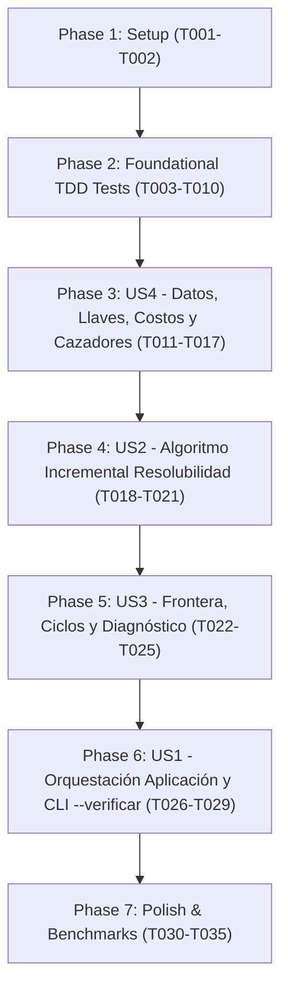

# Tasks: Verificación de Resolubilidad y Extensión del Servicio Web

**Input**: Documentos de diseño desde `specs/003-resolubilidad/` (`spec.md`, `plan.md`, `data-model.md`, `research.md`, `contracts/`, `quickstart.md`).  
**Prerequisites**: `plan.md` y `spec.md` ratificados; principios de `.specify/memory/constitution.md` activos.  
**Tests**: Se incluyen pruebas de aceptación TDD obligatorias en `tests/test_resolubilidad.py`, escritas en primer lugar para que fallen antes de implementar.  
**Organization**: Tareas agrupadas en Fases Foundational, User Stories (P1 a P4) y Polish para ejecución incremental e independiente.

## Format: `- [ ] [TaskID] [P?] [Story?] Description with file path`

- **[P]**: Tarea paralelizable (archivos distintos, sin dependencias con tareas pendientes).
- **[Story]**: Identificador de la historia de usuario (`[US1]`, `[US2]`, `[US3]`, `[US4]`) asignado exclusivamente a fases de historias de usuario.
- Rutas de archivos completas y explícitas en cada tarea, citando los requisitos `FR-###` y `SC-###`.

---

## Phase 1: Setup (Infraestructura Compartida)

**Purpose**: Verificación de entorno y herramientas auxiliares sintéticas.

- [X] T001 Verificar entorno de desarrollo Python 3.13 y dependencias exclusivas en requirements.txt (SC-002)
- [X] T002 [P] Implementar generador procedural determinista de criptas sintéticas (con soporte de tamaño, costos, cadenas de llaves, puertas inestables y cazadores con rango en unidades de costo) en bench/generador_criptas.py (SC-002, SC-005)

---

## Phase 2: Foundational (Pruebas de Aceptación TDD Iniciales)

**Purpose**: Batería de pruebas de aceptación previas en `tests/test_resolubilidad.py`.  
⚠️ **CRÍTICO: Estas pruebas se escriben PRIMERO y deben FALLAR antes de abordar la implementación.**

- [X] T003 Crear módulo base de pruebas de aceptación en tests/test_resolubilidad.py compatible con ejecución vía `python -m tests.test_resolubilidad`
- [X] T004 Implementar escenario de prueba de aceptación `test_FR014_llave_salida_detras_de_su_propia_puerta_con_ciclo` en tests/test_resolubilidad.py para calificar no resoluble y reportar ciclo determinista autorreferencial (FR-014, SC-003, SC-004)
- [X] T005 Implementar escenario de prueba de aceptación `test_FR002_llave_en_suelta_de_errante_en_sala_inicial` en tests/test_resolubilidad.py comprobando que la llave portada por un enemigo se ubica y obtiene en su sala inicial (FR-001, FR-002, FR-010)
- [X] T006 Implementar escenario de prueba de aceptación `test_FR013_varios_ordenes_validos_mismo_orden_determinista` en tests/test_resolubilidad.py comprobando que órdenes topológicos alternativos desempatan de forma idéntica por id de texto en cada etapa (FR-012, FR-013)
- [X] T007 Implementar escenario de prueba de aceptación `test_FR015_cripta_no_resoluble_sin_forzar_no_inicia` en tests/test_resolubilidad.py comprobando bloqueo de partida sin `--forzar` e inicio permitido con `--forzar` (FR-015, FR-016)
- [X] T008 Implementar escenario de prueba de aceptación `test_FR003_endpoint_llaves_cuenta_en_presupuesto_solicitudes` en tests/test_resolubilidad.py comprobando decremento de presupuesto ante consultas HTTP (incluyendo 429) y 0 consultas con versión local coincidente o `--offline` (FR-003, FR-004)
- [X] T009 Implementar escenario de prueba de aceptación `test_FR017_codigos_salida_verificar` en tests/test_resolubilidad.py comprobando códigos de salida 0 (resoluble), 1 (no resoluble) y 2 (falla de red/presupuesto/inexistente) bajo `--verificar` sin crear vistas (FR-017, SC-001)
- [X] T010 Implementar escenario de prueba de aceptación `test_FR018_plantilla_exacta_reporte` en tests/test_resolubilidad.py comprobando formato canónico exacto de secciones `ESTADO:`, `ORDEN DE LLAVES:`, `LLAVES NO OBTENIBLES:`, `FRONTERA BLOQUEADA:`, `UBICACIÓN DE LLAVES:`, `CICLOS DETECTADOS:` y `MOTIVO:` con siglas `N`, `S`, `E`, `O` (FR-018)

**Checkpoint**: Ejecutar `python -m tests.test_resolubilidad` y confirmar que las pruebas fallan limpiamente.

---

## Phase 3: User Story 4 - Obtención e integración de llaves, enemigos y nuevos atributos del servicio web (Priority: P4)

**Goal**: Extender la capa de datos para consumir `GET /criptas/<id>/llaves`, soportar persistencia con control de versión, interpretar costos en salidas (entero $\ge 1$, default 100) y soportar fichas cazador con rango en unidades de costo.  
**Independent Test**: Simular respuestas y verificar persistencia local en `almacen_cripta`, decremento en `presupuesto_solicitudes` y paridad idéntica en modo `--offline`.

### Implementation for User Story 4

- [X] T011 [P] [US4] Declarar método abstracto `llaves(self, id_cripta)` en modelo/datos/fuente_datos.py (FR-001)
- [X] T012 [P] [US4] Implementar método `llaves(self, id_cripta)` en modelo/datos/cliente_http.py consumiendo `presupuesto_solicitudes` ante solicitudes y reintentos 429 (FR-001, FR-003)
- [X] T013 [P] [US4] Implementar método `llaves(self, id_cripta)` en modelo/datos/cliente_offline.py leyendo `criptas/<id>/llaves.json` (FR-001, FR-006)
- [X] T014 [P] [US4] Implementar métodos `tiene_llaves()`, `guardar_llaves(datos)` y `leer_llaves()` con invalidación por versión de cripta en modelo/datos/almacen_cripta.py (FR-004, FR-005)
- [X] T015 [US4] Implementar método `llaves(self, id_cripta)` en modelo/datos/fuente_almacen.py delegando en `almacen_cripta.leer_llaves()` (FR-004)
- [X] T016 [P] [US4] Actualizar interpretación de salidas en modelo/datos/esqueleto.py asignando `costo` como entero $\ge 1$ con valor 100 por defecto (`costo = max(1, int(salida.get("costo", 100)))`) (FR-007)
- [X] T017 [P] [US4] Actualizar datos offline y fixtures en tests/crear_paquete_prueba.py y tests/cripta_de_prueba.py incorporando costos en salidas, cazadores con atributo `"rango"` (en unidades de costo), `llaves.json` con campo `"enemigo"` como ID de texto de la instancia (ej. `"e-1203"`), cripta con ciclo y cripta de referencia con decenas de cazadores, incrementando versiones de catálogo y cripta (FR-005, FR-008)

**Checkpoint**: Pruebas `test_FR002_...` y `test_FR003_...` deben pasar satisfactoriamente.

---

## Phase 4: User Story 2 - Reporte determinista de cripta resoluble con orden de llaves (Priority: P2)

**Goal**: Implementar el algoritmo incremental de resolubilidad por etapas de alcanzabilidad topológica con orden determinista, respetando la Constitución (sin `dict`/`set` como índice, usando `ColaFIFO` y `ordenar()` propias).  
**Independent Test**: Verificar criptas resolubles con múltiples caminos y comprobar que ejecuciones independientes producen la misma secuencia ordenada de llaves por etapas.

### Implementation for User Story 2

- [X] T018 [US2] Crear módulo modelo/juego/resolubilidad.py e implementar preprocesamiento de salas e indexación contigua de cerraduras y listas de espera (`listas_espera = [[] for _ in range(C)]`) usando `esqueleto.posicion()` y búsqueda binaria propia sobre cerraduras únicas ordenadas con `ordenar()` (FR-010, SC-002)
- [X] T019 [US2] Implementar en modelo/juego/resolubilidad.py el bucle principal de BFS por etapas con `ColaFIFO`, asegurando que durante la etapa $k$ solo se crucen puertas abiertas o abiertas en etapas anteriores, registrando llaves encontradas en `llaves_pendientes` y enviando puertas bloqueadas a sus listas de espera (FR-010, FR-012, SC-002)
- [X] T020 [US2] Implementar en modelo/juego/resolubilidad.py el cierre de etapa, la ordenación determinista de `llaves_pendientes` con `ordenar()` lexicográficamente, la liberación de listas de espera (por `id` directo y por `"abre"` del catálogo local si está disponible sin peticiones extra) y la siembra de la siguiente etapa (FR-012, FR-013, SC-002)
- [X] T021 [US2] Implementar en modelo/juego/resolubilidad.py la condición de victoria para calificar `RESOLUBLE` si y solo si se obtiene `llave_salida` y se alcanza `sala_salida` a través de una puerta que la pide (FR-011)

**Checkpoint**: Prueba `test_FR013_...` debe pasar satisfactoriamente.

---

## Phase 5: User Story 3 - Diagnóstico de cripta no resoluble y detección de ciclos (Priority: P3)

**Goal**: Identificar frontera bloqueada, llaves inalcanzables, propagar etiquetas con la regla de la puerta más cercana y detectar ciclos mediante DFS iterativa determinista de 3 colores a partir del mismo recorrido.  
**Independent Test**: Probar con criptas irresolubles por frontera bloqueada y por dependencias circulares (autorreferenciales y encadenadas), validando el reporte canónico exacto.

### Implementation for User Story 3

- [X] T022 [US3] Implementar en modelo/juego/resolubilidad.py el cálculo de la frontera bloqueada, excluyendo estrictamente las puertas cuyas dos salas (origen y destino) ya son alcanzables, ordenadas por `id_sala` ascendente y luego por dirección `N`, `S`, `E`, `O` (FR-014, SC-003)
- [X] T023 [US3] Implementar en modelo/juego/resolubilidad.py la propagación determinista de etiquetas desde la frontera bloqueada hacia salas no visitadas, aplicando la regla de la puerta más cercana (las salas toman como etiqueta la llave de la puerta cerrada más cercana que las bloquea) y construyendo el grafo de dependencias de llaves $X \to Y$ en tiempo lineal $O(S + E)$ (FR-014, SC-002, SC-003)
- [X] T024 [US3] Implementar en modelo/juego/resolubilidad.py la detección determinista de ciclos mediante DFS iterativa de 3 colores con pila propia (`pila = []`, sin recursión), ordenando previamente los nodos con `ordenar()` para garantizar que el ciclo comience y termine en la llave con menor ID de texto (FR-014, SC-004)
- [X] T025 [US3] Implementar en modelo/juego/resolubilidad.py la detección de anomalía de salida (si existe `llave_salida` pero ninguna puerta a `sala_salida` la requiere) y el formateador textual que emite la plantilla exacta canónica del reporte (`ESTADO:`, `ORDEN DE LLAVES:`, `LLAVES NO OBTENIBLES:`, `FRONTERA BLOQUEADA:`, `UBICACIÓN DE LLAVES:`, `CICLOS DETECTADOS:`, `MOTIVO:`) con siglas `N`, `S`, `E`, `O` (FR-011, FR-014, FR-018)

**Checkpoint**: Pruebas `test_FR014_...` y `test_FR018_...` deben pasar satisfactoriamente.

---

## Phase 6: User Story 1 - Verificación previa al inicio del juego y modo de inspección CLI (Priority: P1)

**Goal**: Integrar la verificación en el flujo de arranque de la aplicación con contingencia de red/presupuesto, bloqueo de partida sin `--forzar`, y soporte del modo CLI `--verificar` sin interfaz gráfica.  
**Independent Test**: Ejecutar `--verificar` sobre criptas resolubles e irresolubles comprobando salida y códigos 0/1/2, e intentar iniciar partidas con y sin `--forzar`.

### Implementation for User Story 1

- [ ] T026 [US1] Modificar controlador/aplicacion.py para orquestar la verificación de resolubilidad antes de inicializar la partida, impidiendo el inicio si no es resoluble salvo que se haya especificado `--forzar`, y mostrando el reporte en la interfaz activa (consola o pantalla Pygame) (FR-009, FR-015, FR-016)
- [ ] T027 [US1] Implementar en controlador/aplicacion.py el manejo de contingencia cuando `GET /criptas/<id>/llaves` falla por red o presupuesto sin copia local válida, emitiendo `ESTADO: NO VERIFICADA` con el motivo específico (red o presupuesto) e impidiendo el inicio salvo con `--forzar` (FR-004, FR-009, FR-015)
- [ ] T028 [US1] Modificar main.py para procesar la opción `--verificar <cripta>`, invocando la verificación, imprimiendo el reporte textual en `stdout` y finalizando inmediatamente con códigos de salida 0 (resoluble), 1 (no resoluble) o 2 (no verificada o inexistente) sin crear ninguna vista (ni consola interactiva ni Pygame) (FR-017)
- [ ] T029 [US1] Incorporar argumento `--forzar` en el parser de argumentos de main.py y propagarlo al controlador de la aplicación (FR-016)

**Checkpoint**: Pruebas `test_FR015_...` y `test_FR017_...` deben pasar satisfactoriamente.

---

## Phase 7: Polish & Cross-Cutting Concerns

**Purpose**: Mediciones comparativas de rendimiento, reejecución de benchmarks existentes y ejecución de la suite completa de pruebas.

- [ ] T030 [P] Registrar el subsistema `"resolubilidad"` en el diccionario `BENCHES` de main.py (SC-005, Principio VI)
- [ ] T031 [P] Crear el script bench/bench_resolubilidad.py para comparar el recorrido incremental por etapas $O(S + E + L)$ contra el recorrido repetido por llave $O(L \cdot (S + E))$ sobre criptas con cadenas de llaves $N \in \{10, 50, 100, 200\}$ generadas con bench/generador_criptas.py (SC-001, SC-002, SC-005)
- [ ] T032 Actualizar bench/bench_red.py para incluir la medición del impacto de la consulta `/llaves` en presupuesto de solicitudes y latencia (SC-005, Principio V, Principio VI)
- [ ] T033 Buscar en todos los archivos nuevos y modificados del feature las palabras prohibidas `dict(`, `set(`, `{}` usado como índice, `heapq`, `bisect`, `collections`, `sorted(` y `.sort(` e informar si aparecen, conforme al Principio I de la Constitución (Estructuras propias). No es un test automatizado: es una inspección manual o con grep que debe pasar sin hallazgos antes de ejecutar las pruebas finales (Principio I)
- [ ] T034 Ejecutar todas las pruebas unitarias y de integración del proyecto mediante `python -m tests.<modulo>` asegurando cobertura completa y paso limpio (SC-001)
- [ ] T035 Ejecutar los benchmarks de rendimiento del sistema mediante `python main.py --bench resolubilidad red` y documentar los resultados observados (SC-001, SC-005)

---

## Dependencies & Execution Order

### Phase Dependencies



### User Story Dependencies

- **US4 (Priority: P4)**: Capa de datos y persistencia. No depende de otras historias.
- **US2 (Priority: P2)**: Depende de US4 (disponibilidad de esqueleto y llaves).
- **US3 (Priority: P3)**: Depende de US2 (extiende el recorrido de resolubilidad hacia la frontera bloqueada y ciclos).
- **US1 (Priority: P1)**: Depende de US2 y US3 (utiliza el resultado estructurado de resolubilidad para orquestar la partida y el CLI).

### Parallel Opportunities

- **Setup**: `T002` [P] puede correr en paralelo con la verificación de entorno.
- **User Story 4**: `T011`, `T012`, `T013`, `T014`, `T016` y `T017` son modificaciones en archivos separados y se pueden implementar en paralelo.
- **Polish**: `T030` y `T031` pueden implementarse en paralelo.

---

## Parallel Execution Examples

### Example: Capa de Datos (Phase 3 - US4)

```bash
# Implementación simultánea de adaptadores de fuente de datos y esqueleto:
Task T011: modelo/datos/fuente_datos.py
Task T012: modelo/datos/cliente_http.py
Task T013: modelo/datos/cliente_offline.py
Task T014: modelo/datos/almacen_cripta.py
Task T016: modelo/datos/esqueleto.py
```

### Example: Pruebas y Benchmarks (Phase 7 - Polish)

```bash
# Registro y creación del benchmark de resolubilidad:
Task T030: main.py
Task T031: bench/bench_resolubilidad.py
```

---

## Implementation Strategy

### MVP First (Etapas Fundamentales y Resolubilidad Núcleo)

1. Completar **Phase 1: Setup** y **Phase 2: Foundational** (Escribir pruebas TDD en `tests/test_resolubilidad.py` y validar que fallen).
2. Completar **Phase 3: US4** (Capa de datos y lectura de llaves).
3. Completar **Phase 4: US2** (Algoritmo BFS por etapas e inspección de resolubilidad).
4. **Validar MVP**: Ejecutar `python -m tests.test_resolubilidad` y comprobar paso de pruebas de criptas resolubles.

### Incremental Delivery

1. Setup + Foundational TDD (Fallando).
2. US4 (Datos/API/Esqueleto) $\to$ Pasa prueba `test_FR002_...` y `test_FR003_...`.
3. US2 (Recorrido por etapas) $\to$ Pasa prueba `test_FR013_...`.
4. US3 (Diagnóstico de ciclos y frontera) $\to$ Pasa prueba `test_FR014_...` y `test_FR018_...`.
5. US1 (CLI `--verificar`, contingencia y `--forzar`) $\to$ Pasan pruebas `test_FR015_...` y `test_FR017_...`.
6. Polish (Benchmarks y corrida integral de toda la suite de pruebas).
